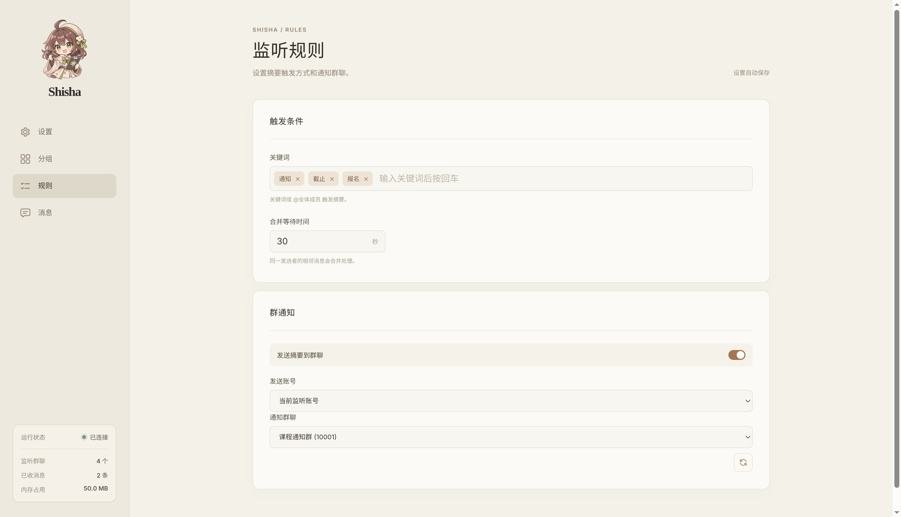
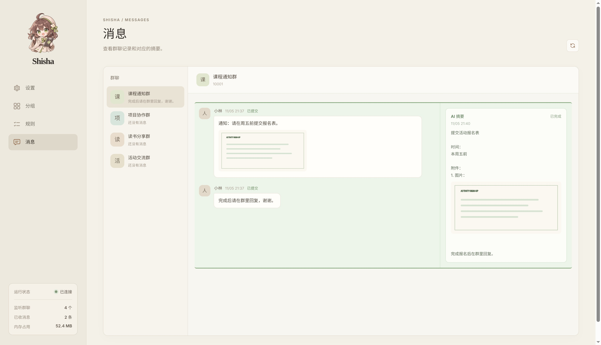
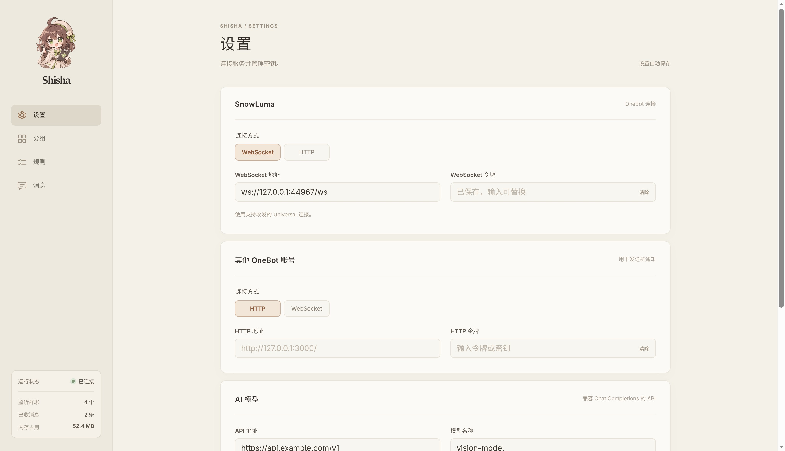
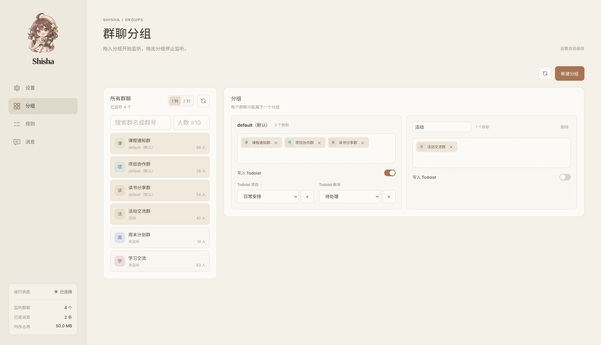

<p align="center">
  
</p>

<h1 align="center">Shisha</h1><p align="center">"ししゃ" 将QQ群通知自动摘要并加入 Todoist 清单内</p>


## 界面截图

<table>
  <tr>
    <td align="center"><br>捕获规则定义</td>
    <td align="center"><br>消息预览</td>
  </tr>
  <tr>
    <td align="center"><br>基础设置</td>
    <td align="center"><br>分组设置</td>
  </tr>
</table>
不用写配置文件，所有的设置都可以通过图形化完成。


## 功能介绍

Shisha 是一个支持 OneBot 协议的小程序，允许你将 QQ 账号内各种各样的通知群的消息汇总，并基于 ```@全体成员``` 和关键字触发自动摘要。这个项目最初是我的[机器人](https://github.com/xiaozhangup/xiaozhangup-bot/blob/master/src/main/kotlin/me/xiaozhangup/bot/func/TaskAbstract.kt)内的一个小模块，但是发现太有用了，而且有一个图片界面配置起来更方便就让 AI 用 Python 单独拆分出来了，并优化了一些功能和配上了一个前端界面。

创建这个项目的原因是大学里面各种群消息太尼玛多了，我自己看肯定是看不过来的，而且我喜欢常开免打扰并把群全部送进群助手，但是重要的通知不看不行，所以只好让一个机器人来帮我盯着我的所有消息了，解放双手✋🤚。

我个人也很喜欢用 Todoist，免费版本功能已经足够覆盖我生活中 99.9% 的需求了，所以所有消息在发到专门的群里的同时也会加入 Todoist 方便我标记哪些处理了哪些没处理。

其他特色：

```
- 消息可以同时发到你制定的 QQ 群（使用你自己的号或者链接其他的 OneBot 发送）
- 支持图片，只要你的大模型支持识图就能用
- 支持多个消息连发，程序会一起交给大模型处理
- 支持 QQ 的富文本消息和转发消息
- 傻瓜式，写上连接地址和 API Key 就能用了（推荐 Snowluma，程序用了它的一些特殊功能，而且它可以直接挂自己的常用 QQ 上）
- 你可以创建多个分组，不同的群消息摘要到不同的 Todoist 项目内
- 还算好看的界面，应该（
```


## 使用方式

运行 `./start.sh` 安装依赖并启动，使用 `./start.sh --port 8080` 指定端口。

我只在 Linux 上测试过，Windows 上需要把 ```.sh``` 换成 ```.bat``` ，不知道能不能行。
